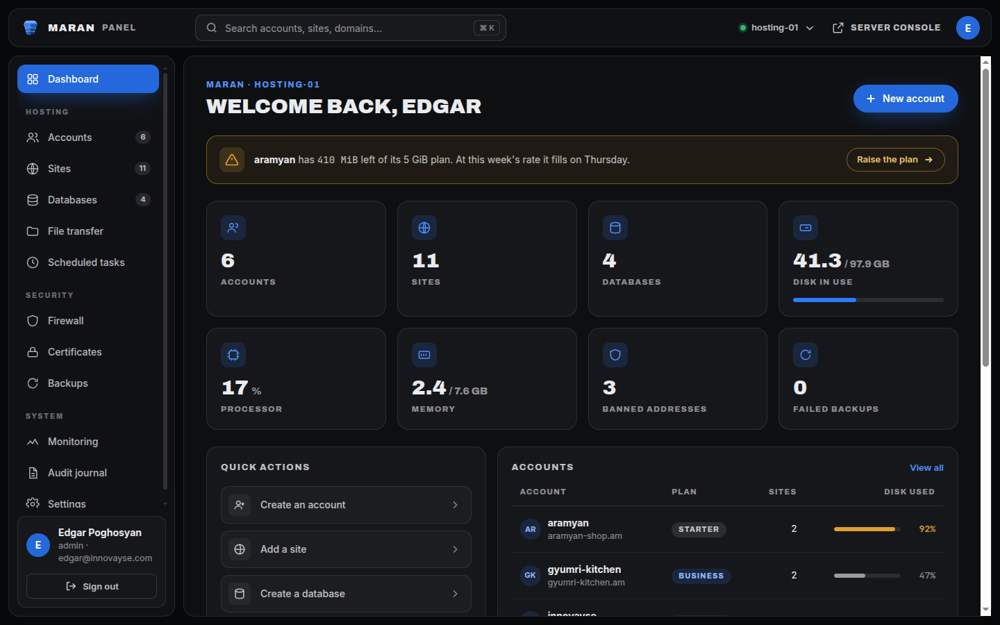
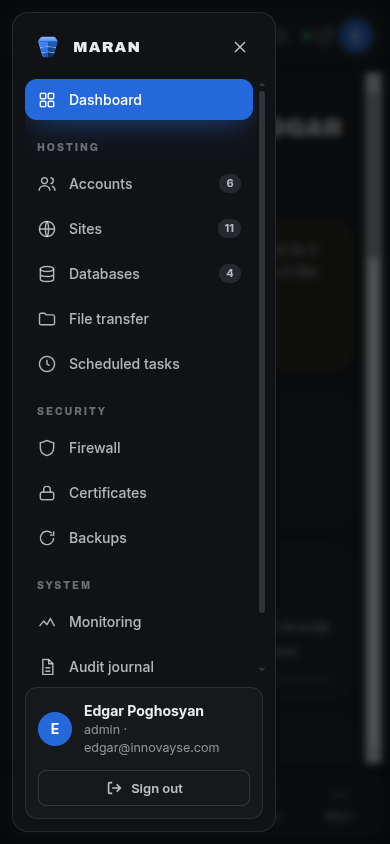
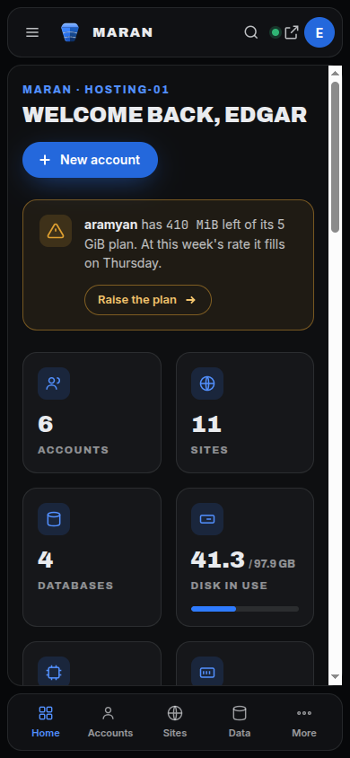

# Maran redesign, October 2026 — read this first

The owner approved a new design for the whole panel (GitHub issue #82). This page is what an
engineer reads before touching `frontend/src/components/ui/`, `frontend/src/components/shell/` or any
page. It records what was approved, the token contract every phase builds against, the measured
reasoning behind the colours, the structure of the shell, the mistakes already made once while building
the mockup, and the one rule that reconciles "rebuild from zero" with the 34 pages and the Playwright
suite that depend on the current components.

`rules/vue.md` (section "Styling") is the binding summary of this page. If the two ever disagree,
fix the disagreement in the same change; do not pick one silently.

## Contents of this folder

| File | What it is |
|---|---|
| `dashboard-mockup.html` | The approved mockup, a single self-contained page. Open it in a browser. |
| `maran-mark.svg` | The keystone mark the mockup uses (the same stone as `frontend/public/favicon.svg`). |
| `dashboard-1440.png` | The mockup at 1440 px. |
| `dashboard-390.png` | The mockup at 390 px. |
| `dashboard-390-menu.png` | The mockup at 390 px with the drawer open. |

The mockup loads its three fonts from Google Fonts so it opens anywhere. **The panel must not**: see
"Type".

## 1. What was approved



- **Direction:** the mockup in this folder. Four earlier directions were built and rejected before it.
  The approved one takes its **structure** from the Innovayse house admin (a flat dark desktop, floating
  rounded panels, a solid accent active item) and its **colours** from Maran's own mark, so Maran reads
  as a product of the same studio and keeps its own identity.
- **Approach: every existing UI-kit component, shell component and page template is deleted and built
  again from zero.** This is a rebuild, not a restyle. Nothing from the current kit is kept and
  recoloured.
- **Why from zero and not a restyle:** the current kit grew around a palette, two typefaces and a set of
  radii that the new design replaces entirely. Recolouring would leave the old decisions fossilised
  inside the component internals, and every leftover would be a place where the two designs disagree.
- **What "from zero" does not mean:** losing what the components do. Section 7 is the contract that
  keeps behaviour intact. Read it before you delete anything.

## 2. The token contract

**`frontend/src/assets/css/main.css` is the source of truth.** This page is written to match it value
for value; if they ever disagree, `main.css` wins and this page is the bug. The names below are fixed:
other phases build against them, and renaming one is a breaking change for all of them. They are
defined once, in `main.css` (Tailwind v4 `@theme`, CSS-first), and a component takes colours from the
Tailwind utilities generated from them. **No component writes a hex value.**

### Colour (dark is the default theme)

| Token | Value | Role |
|---|---|---|
| `--bg` | `#07080A` | The desktop: the flat dark floor the panels float on. |
| `--s1` | `#101216` | Panel surface (app bar, sidebar, content panel). |
| `--s2` | `#16191E` | Raised surface inside a panel (cards, inputs, hover rows). |
| `--s3` | `#1D2126` | The next step up (pressed, deeper). |
| `--b1` | `#23262C` | Border that separates. Decorative. |
| `--b2` | `#2E3339` | Border that emphasises. Decorative. |
| `--bc` | `#656D76` | **Control boundary** — the edge of an input, select, textarea, search field. 3.57 / 3.36 / 3.08:1 on s1 / s2 / s3 (WCAG 1.4.11 needs 3:1). |
| `--t1` | `#E9EBEE` | Text. |
| `--t2` | `#98A0A8` | Muted text and labels. |
| `--t3` | `#828A92` | The faintest **text** tier: captions, secondary lines. It passes as text (see section 3). |
| `--ac` | `#2E7BFF` | Graphics: meters, glow, focus ring. The mark's lit core. **Never a surface under white text, never text.** |
| `--acs` | `rgb(46 123 255 / 0.15)` | Accent wash: icon squares, badges, selected or hovered row. |
| `--acf` | `#2468DC` | **Fill under white text**: active nav item, primary pill, avatar. |
| `--ach` | `#1B55BE` | Hover of `--acf`. |
| `--act` | `#5290FF` | Accent **text and icons** on the dark. |
| `--acl` | `#8FBCFF` | Light accent, for graphics (the keystone's top face). |
| `--gr` | `#2FB574` | Status: ok. |
| `--am` | `#E0A030` | Status: warning. |
| `--rd` | `#E5484D` | Status: error / destructive. |
| `--pu` / `--pus` | `#8B6DF0` / `rgb(139 109 240 / 0.13)` | Secondary accent, for series that must not read as primary. |
| `--glow` | `0 8px 30px -8px rgb(46 123 255 / 0.55)` | The accent glow under the active nav item and the primary pill. Theme-independent. |
| `--shadow-focus` | `0 0 0 2px var(--bg), 0 0 0 4px var(--ac)` | The focus ring (see below). |
| `--shadow-focus-danger` | `0 0 0 2px var(--bg), 0 0 0 4px var(--rd)` | The focus ring on a destructive control. |

**The focus ring is part of the contract.** It is a solid 2 px accent ring set off from the control by a
2 px gap in the page colour, so it stays visible on an accent fill, where a ring of the same blue would
vanish. The old ring was a 14 % wash, nowhere near the 3:1 a focus indicator needs; `--ac` is 4.81:1 on
a dark panel and 3.89:1 on a light one. Use the utilities `shadow-focus` and `shadow-focus-danger`; do
not rebuild a ring by hand.

### Light theme (a second set of values, not a separate design)

The light theme has overrides. Where a dark value cannot work on white, it is replaced by a darker step
of the same blue or hue, with a measurement that forced it. The values that differ from dark:

| Token | Light value | Why it changed |
|---|---|---|
| `--bg` / `--s1` / `--s2` / `--s3` | `#F6F7F9` / `#FFFFFF` / `#F2F4F6` / `#E9ECF0` | Light surfaces. |
| `--b1` / `--b2` | `#E2E5EA` / `#D2D6DD` | Light borders. |
| `--bc` | `#80878F` | Light control boundary: 3.63 / 3.30 / 3.07:1 on s1 / s2 / s3. |
| `--t1` / `--t2` | `#14171B` / `#5C646D` | Light text. |
| `--t3` | `#636B73` | 5.05 / 5.41 / 4.91 on bg / s1 / s2 and 4.57 on s3. |
| `--acs` | `rgb(46 123 255 / 0.10)` | A lighter wash on white. |
| `--act` | `#1B55BE` | `#2468DC` is 5.14:1 on white but only 4.32 / 4.20:1 once the wash sits on the page or on `--s2`, which is exactly where active hover lives. `#1B55BE` clears 4.5:1 on all four surfaces and on the wash over each (5.15 to 6.80). |
| `--acl` | `#2E7BFF` | The lighter ramp steps are less visible on white, so the light accent is the lit core itself (3.89:1 on a panel, 3.63:1 on the page; graphics only). |
| `--gr` | `#17794A` | The dark hue is 2 to 3:1 on white, so as text it fails. |
| `--am` | `#8F5C00` | Same. |
| `--rd` | `#C42B31` | Same. |
| `--pu` / `--pus` | `#6B4BD6` / `rgb(107 75 214 / 0.09)` | Same. |

`--ac`, `--acf` and `--ach` are inherited unchanged (white on `--acf` is 5.14:1 on both themes). The
light theme existed before the redesign with almost no overrides; whether it is **kept** is still an
open decision (section 8).

### Tailwind utilities: use these names

`main.css` feeds the tokens into Tailwind's `@theme inline`, so the utility and `var(--token)` can never
disagree. Components use the utilities; the raw variable is for the few places a utility cannot reach.

| Token | Utilities |
|---|---|
| `--bg` | `bg-page` |
| `--s1` / `--s2` / `--s3` | `bg-surface-1` / `bg-surface-2` / `bg-surface-3` |
| `--b1` / `--b2` | `border-border-subtle` / `border-border-strong` |
| `--bc` | `border-border-control` (form-control edges only) |
| `--t1` / `--t2` / `--t3` | `text-text-primary` / `text-text-secondary` / `text-text-muted` |
| `--ac` | `bg-accent` (graphics only) |
| `--acs` | `bg-accent-soft` |
| `--acf` | `bg-accent-fill` |
| `--ach` | `hover:bg-accent-hover` |
| `--act` | `text-accent-text` |
| `--acl` | `text-accent-light` |
| `--gr` / `--am` / `--rd` | `text-success` / `text-warning` / `text-danger` |
| `--pu` / `--pus` | `text-violet` / `bg-violet-soft` |
| `--glow` | `shadow-glow` |
| focus ring | `shadow-focus`, `shadow-focus-danger` |
| `--r-panel` (16 px) | `rounded-panel` |
| `--r-control` (12 px) | `rounded-control` |
| `--r-inset` (8 px) / `--r-row` (6 px) / `--r-mark` (4 px) | `rounded-inset` / `rounded-row` / `rounded-mark` |
| display / body / figures | `font-display` / `font-sans` / `font-mono` |

> **Keep using `text-text-muted` for secondary text. Do not migrate it.** That utility is used 86 times
> across the panel for real labels, captions and secondary lines. The old `--t3` (`#6A7178`) failed 4.5:1
> on every surface, and that defect **pre-dates the redesign**. It was fixed in the token (`#828A92`),
> not at the 86 call sites. A rebuilt component that uses `text-text-muted` for a caption is correct; do
> not "upgrade" it to `text-text-secondary` or to a new utility to dodge a contrast problem that no
> longer exists. `--t3` is still visibly dimmer than `--t2`, which is the point of having a third tier.

The mockup uses its own working names. Where you read the mockup's CSS, translate:

| Mockup | Contract |
|---|---|
| `--desk` | `--bg` |
| `--accent` / `--accent-fill` / `--accent-hover` / `--accent-text` / `--accent-light` | `--ac` / `--acf` / `--ach` / `--act` / `--acl` |
| `--ok` / `--warn` / `--bad` | `--gr` / `--am` / `--rd` |
| `--shadow-accent` | `--glow` |
| `--paper`, `--p80` … `--p03` | `--t1` and its alpha steps; prefer `--t1` / `--t2` / `--t3` over a new alpha |
| `--a15`, `--a40` | `--acs`, and the accent at higher alpha for a hover border |

### Shape and type

| Token | Value |
|---|---|
| `--r-panel` | `16px`: shell panels and cards |
| `--r-control` | `12px`: inputs, selects, ghost buttons, nav items, quick-action rows |
| `--r-inset` | `8px` (`--r-control` - 4px): a control nested in a control's 4px padding (segmented-control segment, in-field reveal / clear button, close button); concentric with its outer shape |
| `--r-row` | `6px` (`--r-control` - 6px): a row inside a menu or listbox panel's 6px padding (dropdown item, option) |
| `--r-mark` | `4px` (`--r-control` / 3): the checkbox box, a small glyph that must stay a rounded square |
| Pills | the primary action is a full pill (`999px`, as in the mockup); it is the one fully rounded control |
| Display font | **Archivo** (800 to 900) for titles, figures and uppercase labels |
| Body font | **Inter** |
| Figures that must align | **JetBrains Mono**, with `tabular-nums` |
| Armenian | **Noto Sans Armenian**, in every stack |

The stacks, exactly as `main.css` defines them:

```
--font-display: 'Archivo', 'Inter', 'Noto Sans Armenian', system-ui, sans-serif
--font-sans:    'Inter', 'Noto Sans Armenian', system-ui, sans-serif
--font-mono:    'JetBrains Mono', 'Noto Sans Armenian', ui-monospace, monospace
```

Maran ships en, ru and hy and no single face covers all three. **Archivo has no Cyrillic**, so Russian
display text falls through to Inter, which does; none of the Latin faces has Armenian, so that falls
through to Noto Sans Armenian. Latin glyphs always come from the primary face. The old faces
(Public Sans, Azeret Mono) and the old 5 px radius are gone with the old kit.

### Type: self-hosted, always

The panel serves its fonts itself (`frontend/public/fonts/*.woff2`, declared in
`frontend/src/assets/css/fonts.css`, no Google Fonts link in `index.html`) in the **latin, latin-ext,
cyrillic, cyrillic-ext and armenian** subsets. The mockup's Google `<link>` is a convenience for opening
the file anywhere. **The rebuild must not introduce any request to `fonts.googleapis.com` or
`fonts.gstatic.com`.** A control panel is often installed on a server with restricted egress, and a font
request that cannot be answered shows up as a layout that shifts.

Text sizes stay Tailwind's own steps (`rules/vue.md` "Text sizes are Tailwind's own steps"). The
redesign changes the font and the weight, not the scale: a large uppercase display title is `text-2xl`
or larger in the display face, an uppercase micro-label is `text-xs` in the display face with
letter-spacing, body is `text-sm`.

## 3. Contrast: measured, not eyed

Every blue in the design is a step of the one ramp in the mark (`#E4F0FF` down to `#0C2E63`, lit at
`#2E7BFF`). Which step goes where was decided by measuring contrast. WCAG 2.2 AA needs 4.5:1 for text
and 3:1 for graphics and control boundaries. The dark-theme figures below were recomputed from the
`main.css` hex values with the WCAG relative-luminance formula.

### The one most likely mistake

> **White text on `#2E7BFF` is 3.89:1 and fails.** 14 px semibold text needs 4.5:1 (WCAG "large text"
> starts at 18.66 px bold, not 14 px). The mark's own core blue must never sit under white text. That
> is the reason `--acf` exists: **any surface that carries white text is `--acf`**, and `--ac` is for
> things that carry no text.

### Dark theme

| Pairing | Ratio | Verdict |
|---|---|---|
| white on `--ac` `#2E7BFF` | 3.89:1 | **fails text** |
| white on `--acf` `#2468DC` | 5.14:1 | passes |
| white on `--ach` `#1B55BE` (hover) | 6.80:1 | passes |
| `--ac` against the `--s2` track (meter) | 4.52:1 | passes as a graphic (3:1) |
| `--ac` against `--b1` | 3.89:1 | passes as a graphic |
| `--act` `#5290FF` on `--s1` | 6.06:1 | passes text |
| `--act` on the `--acs` wash over `--s1` / `--s2` | 5.15 / 4.78:1 | passes text |
| `--act` on the `--acs` wash over `--s3` | **4.40:1** | **fails text** (see residual risks) |
| `--acl` `#8FBCFF` on `--s1` | 9.65:1 | passes (graphics) |
| `--t1` on `--bg` / `--s1` / `--s2` | 16.77 / 15.70 / 14.75:1 | passes |
| `--t2` on `--bg` / `--s1` / `--s2` | 7.56 / 7.08 / 6.65:1 | passes |
| `--t3` on `--bg` / `--s1` / `--s2` / `--s3` | 5.72 / 5.36 / 5.03 / 4.62:1 | passes text on all four |
| `--gr` / `--am` on `--s1` | 7.13 / 8.25:1 | passes |
| `--rd` on `--bg` / `--s1` | 5.12 / 4.79:1 | passes |
| `--rd` on `--s2` | **4.502:1** | passes by a hair, right at the line |
| `--rd` on `--s3` | 4.13:1 | **fails text** |
| `--b1` against `--s1` | 1.24:1 | decoration only; not a control boundary |
| `--b2` against `--s1` | 1.47:1 | decoration only; not a control boundary |
| `--bc` against `--s1` / `--s2` / `--s3` | 3.57 / 3.36 / 3.08:1 | passes 1.4.11 as a control boundary |

Light-theme figures for the values that changed are in the light-theme table in section 2 (for example
`--t3` 5.05 / 5.41 / 4.91 / 4.57:1 and `--act` over the wash 5.15 to 6.80:1).

### `--t3` was a defect before the redesign

The old `--t3` (`#6A7178`) was documented as "decoration only", but the utility it backs,
`text-text-muted`, is used 86 times for real labels, captions and secondary lines. It measured
4.05 / 3.79 / 3.56:1 on `--bg` / `--s1` / `--s2`: it failed on every surface, so those 86 places were
already failing contrast. The redesign did not cause that. It was fixed in the token (`#828A92` dark,
`#636B73` light), not at the call sites, and that is why the call sites must stay as they are (section
2).

### Residual risks: rules for the rebuild

These pairings are not covered by a token and are known to fail or sit at the edge. Treat each as a
rule:

- **Never put accent text on an accent wash laid over the pressed surface.** `--act` on `--acs` over
  `--s3` is 4.40:1, under 4.5:1. On `--s1` and `--s2` it passes (5.15 / 4.78); on `--s3` it does not.
  If a selected or hovered state sits on `--s3`, change the surface or the text, and measure.
- **`--rd` as text is at the line on `--s2` (4.502:1) and fails on `--s3` (4.13:1).** Do not put error
  text on `--s3`. On `--s2` a change of one hex digit anywhere in the stack tips it under, so re-measure
  if either token moves.
- **Badge text on a status-coloured wash is NOT tokenised and was not measured.** A badge puts `--gr`,
  `--am` or `--rd` text on a low-alpha wash of itself over a surface, a pairing no token covers. **The
  badge component must measure its own pairs**, for every status, on every surface it can sit on, in
  both themes, and record the numbers in its doc comment. Do not assume the text-on-surface figures
  above carry over.
- **A control's boundary needs 3:1 (WCAG 1.4.11) when it is the only thing that marks the control.**
  `--b1` and `--b2` do not reach it. An input, select or ghost button that relies on its border alone
  must get a boundary that does (a fill against the panel, or a stronger border); measure it and put the
  number in the component's doc comment. **The kit's answer is `--bc` (`border-border-control`)**: a
  token of its own, not a reuse of `text-text-muted`, so retuning the text tier never moves a field edge.

### Other rules that follow from the numbers

- **A warning is amber, not blue.** With a blue brand a blue notice reads as "information". An account
  running out of room uses `--am`, the meaning that token already carries.
- **The mark has no plate behind it.** A filled square under the keystone puts one blue on another and
  loses the stone's edges (`UiBrandMark.vue` already records this).
- Status colour is never the only carrier of meaning: text always accompanies it.
- Phase PRs re-measure every pairing they ship rather than trusting this table.

## 4. Structure



### Desktop (1024 px and up)

- **A flat dark desktop** (`--bg`) with rounded panels (`--r-panel`) floating on it, **12 px apart**:
  the app bar on top, the sidebar on the left, one content panel.
- **The content panel is the only element that scrolls.** The shell never does. This is why a long page
  never drags the app bar or the sidebar with it.
- **App bar (56 px):** the mark and wordmark (`ShellWordmark`, shared with the drawer's head row; plain content or a link, never a heading), a search field with a `⌘K` hint, the server selector, a
  link out, the user's avatar.
- **Sidebar (240 px):** items in groups under small uppercase group labels, count badges on the right.
  **The active item is a solid `--acf` fill with white text and `--glow` under it**; inactive items are
  `--t2` with a tinted hover. **The signed-in user's card sits at the bottom**, with the sign-out
  button.
- **Page header:** a small uppercase accent line (`--act`), a large uppercase display title, and the
  primary action as a full pill in `--acf` with `--glow`.
- **KPI cards:** an icon in a tinted rounded square, a large display figure, an uppercase label. They
  lift 2 px and take an accent border on hover. **Every bar carries its figure as visible text.**
- **Quick actions** are bordered rows with an icon square and a chevron, not a bare list.
- Figures count up from zero on arrival; skipped under `prefers-reduced-motion`, and the real value is
  always in the markup.

### Below 1024 px: a drawer and a tab bar



The sidebar does not vanish; it **becomes a drawer**.

- The same navigation, in a rounded panel that slides in from the left with 12 px of desktop around it,
  over the page **darkened and blurred**. A head row carries the mark, the wordmark and a close button;
  the user's card and sign-out stay at the bottom; the list scrolls between them.
- A **bottom tab bar** of five destinations appears. KPI grid: 4 columns become 2.
- **Opened by** the hamburger in the app bar **and** by the tab bar's "More".
- **Closed by** its own close button, a tap on the backdrop, choosing a destination, **and `Escape`**.
- **Focus** moves to the close button on open; `Tab` stays inside the drawer while it is open (focus is
  held); on close focus returns to whatever opened it. `aria-expanded` on both triggers follows the
  state. Widening past 1024 px with the drawer open drops the open state.
- The Innovayse admin this structure comes from does not close on `Escape` (measured: the drawer stayed
  on screen after the key). A modal panel must, and Maran's does. Each of these behaviours must be
  asserted by a Playwright spec at 390 px (an acceptance criterion of #82).
- **No screen scrolls horizontally at 390 px**, in any of the three languages.

## 5. Pitfalls already found

The mockup hit each of these. Every one was caught only by looking at a screenshot, not by reading the
code. Do not repeat them.

- **White on `#2E7BFF`** fails contrast (section 3).
- **Descendant selectors catching the avatar.** `.who span { display: block }` also matched the round
  initials badge, which is a `<span>`, and broke its centring; the same bug hid the mark at tablet
  width. Scope a text rule to the text element, with a class, not to every `span`.
- **Cascade order on display utilities.** A mobile-only control declared `display: none` lost to a later
  generic `display: grid`, and showed on desktop. When a control is hidden by breakpoint, check the
  order the declarations reach the browser, not the order you wrote them.
- **Wrapping.** The search placeholder and the `⌘K` hint wrapped onto two lines at 768 px; a notice with
  a button beside it collapsed to one word per line at 390 px. Give such rows `whitespace-nowrap` where
  they must stay one line, and a stacking breakpoint where they must not squeeze.
- **Long Armenian uppercase labels.** The Innovayse admin itself overflows at 390 px: labels such as
  «ՀԱՅՏԱՐԱՐՈՒԹՅՈՒՆՆԵՐ» push its content panel into a horizontal scroll, and its tab bar truncates
  («Նորությու…»). Maran ships Armenian too. Labels must wrap (`overflow-wrap: anywhere`), tab-bar labels
  must be short enough to fit, and no screen may scroll horizontally at 390 px. Check every screen at
  390 px in `hy` before calling it done.
- **A bar with only `aria-*`.** `UiMeter` exposes its label and value to assistive technology through
  `aria-*` only, so a card that passes them and stops shows three unlabelled stripes. Every bar needs
  its figure as visible text.
- **A cell coloured by a class.** `UiTableCell` used to bake in a primary colour, so a caller's
  `text-text-muted` on the cell or its content won or lost by stylesheet order and every "muted" date
  rendered primary. The colour comes only from the cell's `tone` prop (section 7, "Kit API").
- **A table that squashes.** Content allowed to break anywhere (`wrap-anywhere`, `break-all`) has a
  one-character minimum width, so the browser shrinks the column to a letter per line. Cells keep a
  floor width and badges never wrap; the table grows past its wrapper and scrolls inside it, never the page.
- **Two `h1`s.** An authenticated page's own title is its one `h1`; the app bar's wordmark is not a
  heading. On the signed-out screens the layout's wordmark is the `h1` and the page opens with an `h2`.
- **API property names as labels.** The account form labelled the plan picker "Plan ID" (#80). A label
  is for the person, not the payload.

## 6. Acceptance, in short

The full list is on issue #82. The parts that bite while rebuilding a component:

- WCAG 2.2 AA with contrast **measured** for every token pairing; focus visible on every control;
  targets at least 24 x 24 px.
- Fonts self-hosted; no request to `fonts.googleapis.com` or `fonts.gstatic.com`.
- Keyboard: every control reachable in reading order with a visible focus ring.
- `npm run lint && npm run typecheck && npm run build` and `maran structure` pass; the Playwright suite
  passes.
- Every screen screenshotted at 1440, 768 and 390 px and attached to its PR.

## 7. The reconciliation every component rebuild must follow

> **A component is rewritten from zero, but it keeps its public API (props, emits, slots, exposed
> methods) and its ARIA roles and accessible names.**

Rebuild the internals and the look. Keep the contract. The reasons are concrete:

- **34 pages** compose these components. A renamed prop, a dropped slot or a changed emit is a change in
  every page that uses it, and the point of the rebuild is the look, not a rewrite of the screens.
- **The Playwright suite (73 spec files) asserts on roles and accessible names, not on classes.** A
  rebuilt kit that keeps the semantics keeps the suite green. A spec changes only when the behaviour it
  asserts is deliberately changed, and the spec's own comment says which behaviour — never to make a
  rewrite pass.
- **The existing components record real defects in their doc comments**, each a bug the component exists
  to prevent. Read the component before deleting it and carry its lesson into the replacement; the
  lesson is part of the contract.

In practice, per component:

1. Read the old component's props, emits, slots, `defineExpose`, roles, `aria-*` and the doc comments.
   Write them down; that list is the target.
2. Write the new component from an empty file against the tokens in section 2. Do not paste markup or
   classes from the old one.
3. Keep every prop name, type and default, every emitted event and its payload, every slot name, and
   every exposed method. Adding is allowed; removing or renaming is a deliberate API change that needs
   its own justification and the pages updated in the same change.
4. Keep the role and the accessible-name source (the label prop, the `aria-label`, the heading) so the
   specs that find it by role and name still find it.
5. The rules that did not change still bind the new code, unweakened: UI kit only, raw `button`,
   `input`, `select`, `textarea`, `table`, `form` only inside `components/ui/`, const arrow functions
   with doc comments, API composables from stores only, the backend owns every message text, all text
   through i18n in `en`, `ru` and `hy`.

### Kit API the rebuild added

Props and parts that did not exist before the rebuild. Each is documented on the component; use them
instead of a class on the tag, an `!` modifier or a selector that reaches into another component.

| Component | API | Why it is a prop |
|---|---|---|
| `UiButton` | `to` renders a `RouterLink` (role `link`) in the same box; `type` and `disabled` are ignored on a link. `size`: `md`, `bar`, `icon`, `icon-sm`, `tab`, independent of `variant`. | Navigation is a link, never a button that calls `router.push`: a link keeps middle-click, "open in new tab" and the right role. |
| `UiInput` | `mono` (machine text), `icon` (decorative leading glyph), `inputmode`, `disabled`. `UiPasswordInput` forwards `icon` and `disabled`, not `inputmode`. | An attribute on the tag lands on the wrapper `div`, not the `<input>`. A password is free text, so no `numeric` keyboard. |
| `UiTableCell` | `tone`: `primary`, `secondary`, `muted`; `mono` for figures. | The colour comes only from `tone`, never from a `text-text-*` class (stylesheet order would decide). A cell has a minimum width, so a table scrolls inside its container instead of squashing. |
| `UiMeter` | `tone`: `capacity` (default; warns past 80 %, danger at 100 %) or `progress` (colour from `status`: `running`, `success`, `danger`); `showValue` (default on). | For a task a full bar is success, so the ratio cannot pick the colour. The figure is visible text unless the caller prints it. |
| `UiSearchInput` | Combobox mode: `inputRole="combobox"`, `ariaControls`, `ariaExpanded`, `ariaActivedescendant`. | These must reach the `<input>`, not the wrapper. Defaults are the plain `searchbox`. |
| `UiAvatar` | `name`, `size` (`sm` 32 px, `md` 36 px); the letters come from `utils/initialsOf`. | One initials disc for the identity card, the accounts table and the journal. White on `--acf`; decorative, the name is printed beside it. |
| `UiIconTile` | `name` or the default slot; `size`: `sm`, `md`, `lg`. | One accent icon square. `--act` on `--acs` passes on `--s1` and `--s2` but is 4.40:1 on `--s3`, so **a tile never sits over `--s3`**. Decorative. |
| `UiAuthHeading` | `title`, `subtitle`. | The title of a signed-out page, an `h2`; wraps long Armenian and Russian words (`wrap-anywhere`) instead of widening the panel. |
| `ShellWordmark` | `collapsible`. | The mark and name in the app bar and the drawer head; no heading semantics. |

The radius tokens (`rounded-inset`, `rounded-row`, `rounded-mark`) are already documented in section 2 (the utilities table and "Shape and type").

**One `h1` per screen.** An authenticated page's title (`UiPageHeading`) is the document's only
`h1`; the app bar's wordmark is a link, not a heading. The auth layout has no page title above its
card, so its wordmark is the `h1` and each auth page opens with `UiAuthHeading` (`h2`).

## 8. Open decision

**Light theme: keep it or drop it?** The panel has a light/dark switcher today
(`ShellThemeSwitcher.vue`); the mockup is dark only. The tokens carry measured light values (section
2), but keeping the theme doubles the contrast work on every component, and dropping it is a product
decision, not a technical one. Until the owner decides, dark is the design and light must keep passing
the numbers in section 2. Whichever way it goes, record
the answer here and in `rules/vue.md`.
